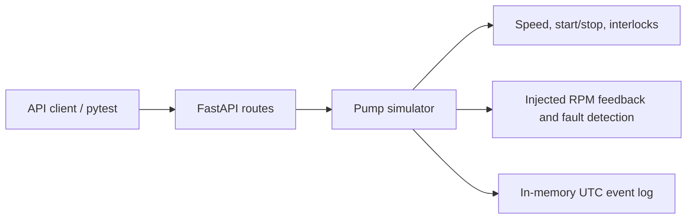

# Virtual Laboratory Pump — Automated Testing & Fault Simulation

[](https://github.com/ReyhaneVahidi/virtual-pump-testing/actions/workflows/tests.yml)

A **software-only laboratory pump simulator** built with **Python, FastAPI, and pytest**. It provides a reproducible environment for testing pump control, fault detection, recovery interlocks, and HTTP error handling **without requiring physical hardware**.

The project focuses on **software testing and system validation**, not on fluid dynamics or a real motor driver.

## What it demonstrates

- **Pump control:** set the commanded speed (1–300 RPM), start, and stop.
- **Fault injection:** disconnect/reconnect a simulated sensor and fail/reset a simulated motor.
- **RPM feedback monitoring:** distinguish commanded RPM from explicitly injected simulated feedback; detect blocked, underspeed, and overspeed conditions.
- **Safe-stop and recovery behavior:** faults stop the simulated pump; latched feedback and motor faults require a reset and a separate start command.
- **Diagnostic event history:** query structured events with UTC timestamps, sequence IDs, and fault codes.
- **Automated verification:** pytest unit tests and FastAPI integration tests; GitHub Actions runs them on every push and pull request.

## System overview



The application uses one in-memory `Pump` instance per running API application. Each integration test creates its own instance to prevent state leakage.

## Getting started

Requires **Python 3.11+** and Git. Run these commands from the repository root.

**Windows / PowerShell**

```powershell
git clone https://github.com/ReyhaneVahidi/virtual-pump-testing.git
cd virtual-pump-testing
python -m venv .venv
.\.venv\Scripts\Activate.ps1
python -m pip install -r requirements.txt
python -m pytest -v
```

**Linux / macOS**

```bash
git clone https://github.com/ReyhaneVahidi/virtual-pump-testing.git
cd virtual-pump-testing
python3 -m venv .venv
source .venv/bin/activate
python -m pip install -r requirements.txt
python -m pytest -v
```

Start the API in a separate terminal:

```powershell
python -m uvicorn api:app --reload
```

Open the interactive API documentation at **http://127.0.0.1:8000/docs**. The example server runs locally and should not be exposed publicly; the simulation endpoints have no authentication.

## Try a fault scenario

With the server running, use another **PowerShell** terminal:

```powershell
# 1. Set the commanded speed and start the virtual pump.
Invoke-RestMethod -Method Post http://127.0.0.1:8000/speed/150
Invoke-RestMethod -Method Post http://127.0.0.1:8000/start

# 2. Inject zero RPM while the command remains at 150 RPM.
Invoke-RestMethod -Method Post http://127.0.0.1:8000/simulation/feedback `
  -ContentType 'application/json' -Body '{"measured_rpm": 0}'

# 3. Inspect the detected fault and logged events.
Invoke-RestMethod http://127.0.0.1:8000/status
Invoke-RestMethod http://127.0.0.1:8000/events

# 4. Reset the latched fault and deliberately restart.
Invoke-RestMethod -Method Post http://127.0.0.1:8000/simulation/feedback/reset
Invoke-RestMethod -Method Post http://127.0.0.1:8000/start
```

After step 2, `/status` reports the **commanded** speed as `150`, the last **measured** speed as `0.0`, `feedback_fault_code` as `"BLOCKED"`, and `running` as `false`.

### RPM fault detection rules

Measurements are **manually injected** by a caller; they are not obtained from a physical tachometer. When a healthy pump starts, its default simulated reading equals the commanded RPM until an explicit feedback update is supplied.

| Condition | For a 150 RPM command | Result |
| --- | --- | --- |
| `measured_rpm == 0` | 0 RPM | `BLOCKED` |
| `0 < measured_rpm < 80% of command` | e.g. 100 RPM | `UNDERSPEED` |
| `80% ≤ measured_rpm ≤ 120%` | 120–180 RPM | Normal operation |
| `measured_rpm > 120% of command` | e.g. 200 RPM | `OVERSPEED` |

A detected feedback fault is **latched** and stops the virtual pump. The anomalous reading is retained for inspection until the fault is reset. Detection is deterministic and immediate upon a submitted feedback reading; there is no continuous sensor sampling or time-based physics model.

## API reference

| Method | Path | Behavior |
| --- | --- | --- |
| `GET` | `/status` | Show commanded speed, last measured RPM, running state, and faults |
| `POST` | `/speed/{rpm}` | Configure pump command, 1–300 RPM |
| `POST` | `/start` | Start when all prerequisites are satisfied |
| `POST` | `/stop` | Stop without clearing latched faults |
| `POST` | `/simulation/sensor/disconnect` | Lose sensor signal and stop the pump |
| `POST` | `/simulation/sensor/reconnect` | Restore sensor signal (no automatic restart) |
| `POST` | `/simulation/motor/fail` | Inject a latched motor failure |
| `POST` | `/simulation/motor/reset` | Clear the motor failure (no automatic restart) |
| `POST` | `/simulation/feedback` | Submit `{"measured_rpm": 150}` and evaluate RPM deviation |
| `POST` | `/simulation/feedback/reset` | Clear a latched RPM feedback fault |
| `GET` | `/events?limit=100` | Read recent structured events, in chronological order |

**Error handling:** invalid speed ranges return `400`; prohibited operations return `409`; invalid API parameters or JSON bodies return `422`. Feedback readings must be finite numbers in the range 0–1000 RPM and can be submitted only while the virtual pump is running.

### Event record example

`GET /events` returns `{"events": [...], "total": N}`. A detected feedback fault produces an entry in this format (values shown are illustrative):

```json
{
  "id": 4,
  "timestamp_utc": "2026-11-18T10:00:00.000Z",
  "type": "feedback_fault_detected",
  "details": {
    "fault_code": "BLOCKED",
    "commanded_rpm": 150,
    "measured_rpm": 0.0
  }
}
```

Events are **held only in memory**: restarting the server clears both pump state and event history. There is no database, file persistence, or external monitoring service.

## Testing and CI

Run the complete test suite:

```powershell
python -m pytest -v
```

The tests cover:

| Test area | Example cases |
| --- | --- |
| Operating controls | Start/stop, speed boundaries, rejected requests |
| Safety interlocks | Sensor loss, motor failure, independent fault recovery |
| RPM monitoring | Blocked, under/overspeed, exact tolerance thresholds, invalid inputs |
| HTTP integration | Response codes, payload validation, isolated app state |
| Event logging | Timestamp formatting, event sequence, filtering, fault details |

The workflow at `.github/workflows/tests.yml` installs dependencies and executes pytest on an Ubuntu runner with Python 3.13 on every push and pull request. Local development has also been tested on Windows using Python 3.11.

## Requirements-based verification documentation

The project also includes a **requirements-based test specification** as an example of structured software verification and validation (V&V). Eight internally defined, testable requirements are linked to ten verification cases and the existing automated pytest functions:

| Artifact | Purpose |
| --- | --- |
| [Software requirements](docs/testing/requirements.md) | Eight verifiable expected behaviors (REQ-001 to REQ-008) |
| [Test cases](docs/testing/test_cases.md) | Preconditions, test steps, expected results, and test IDs (TC-001 to TC-010) |
| [Requirements Traceability Matrix](docs/testing/traceability_matrix.md) | Requirement → test case → pytest test functions → run status |
| [Test execution report](docs/testing/test_report.md) | Dated actual results, environment, Python version, commit ID, and Pass/Fail status |

To **execute all tests and regenerate** the RTM and execution report for the current checkout:

```powershell
python tools/generate_test_report.py
```

The report distinguishes observed test results from expected behavior. A case passes only if **all mapped pytest functions** have executed and passed (including parameterized tests). These are **portfolio-defined requirements for a software simulator**, not specifications provided by Siemens or requirements validated on physical medical hardware.

## Repository layout

```text
virtual-pump-testing/
├── .github/workflows/tests.yml    # Automated CI test workflow
├── api.py                         # FastAPI routes and request validation
├── pump.py                        # Simulation logic and event records
├── tests/
│   ├── test_pump.py              # Unit tests
│   └── test_api.py               # API integration tests
├── docs/testing/                 # Requirements and verification evidence
│   ├── requirements.md
│   ├── test_cases.md
│   ├── traceability_matrix.md
│   ├── test_report.md
│   └── test_mapping.json
├── tools/generate_test_report.py # Execute pytest and refresh evidence
├── requirements.txt              # Python dependencies
├── test-pump.ipynb               # Early exploratory notebook
└── README.md                      # Project documentation
```

## Scope and limitations

This is an **educational software-in-the-loop simulation**. The pump does not move liquid or control an actuator, the feedback is synthetic, and failure thresholds are illustrative test settings rather than calibrated engineering or medical limits. It does **not** constitute physical system verification, real-time control, or medical-device safety validation.

The objective is to practice and demonstrate Python software design, reproducible tests, fault-injection scenarios, and continuous integration.
